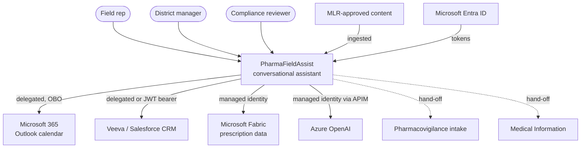
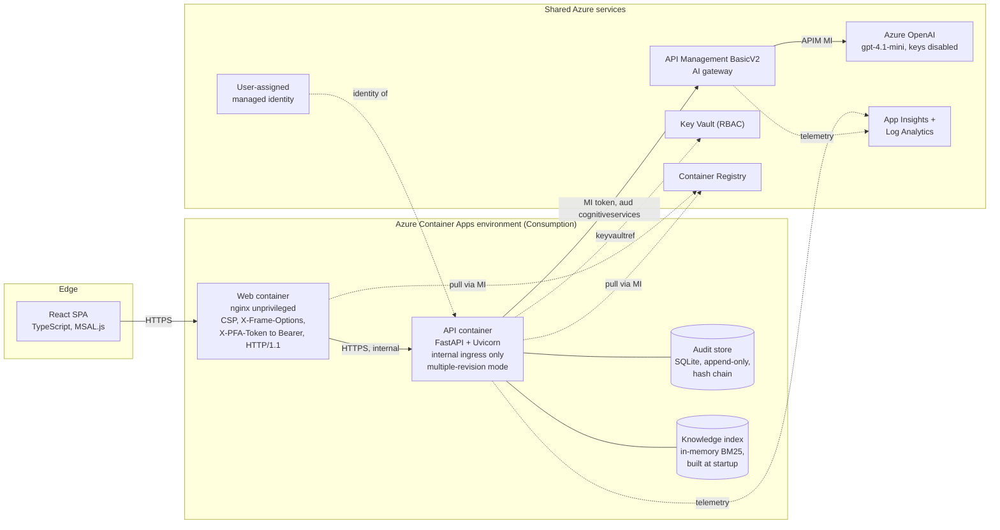
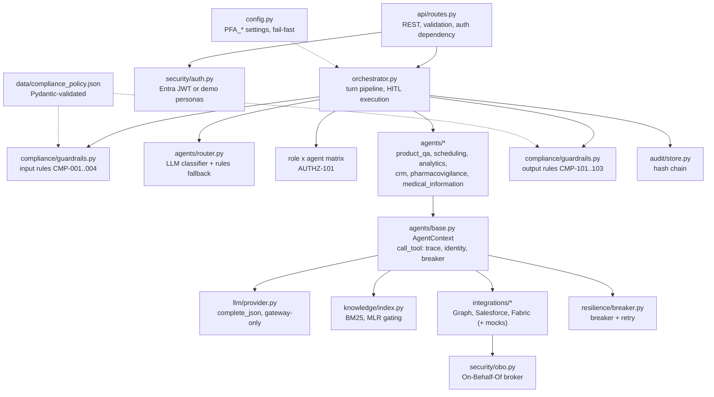
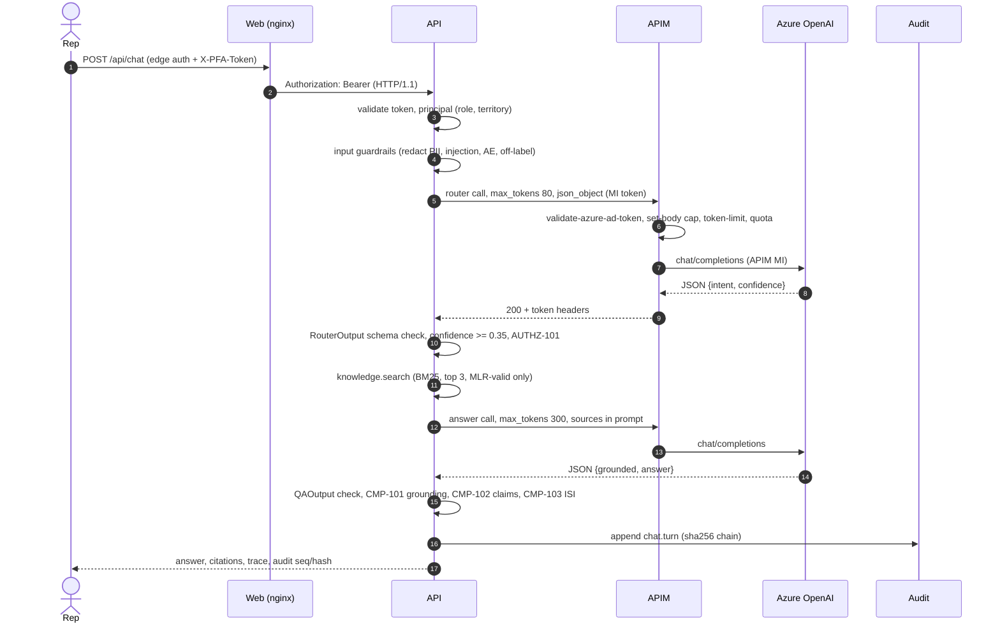
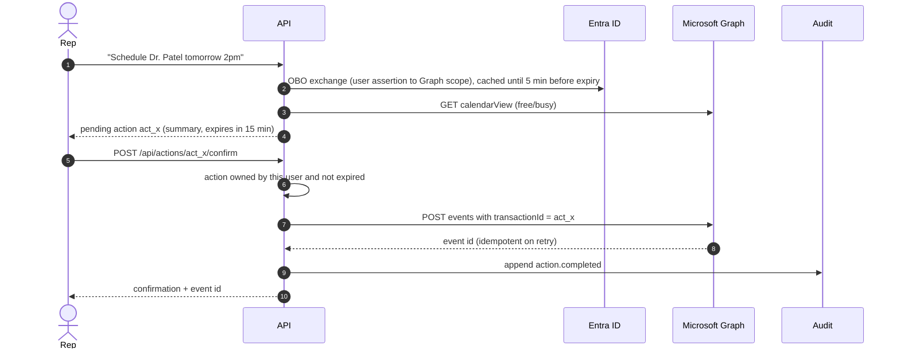
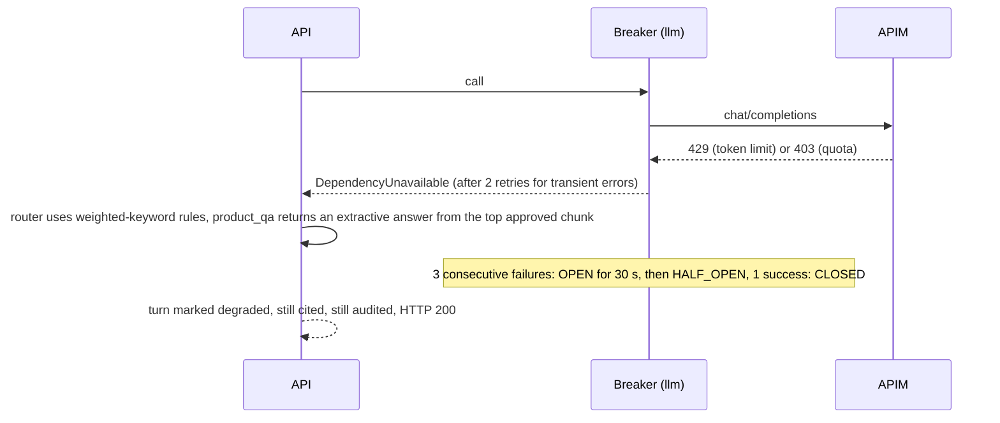
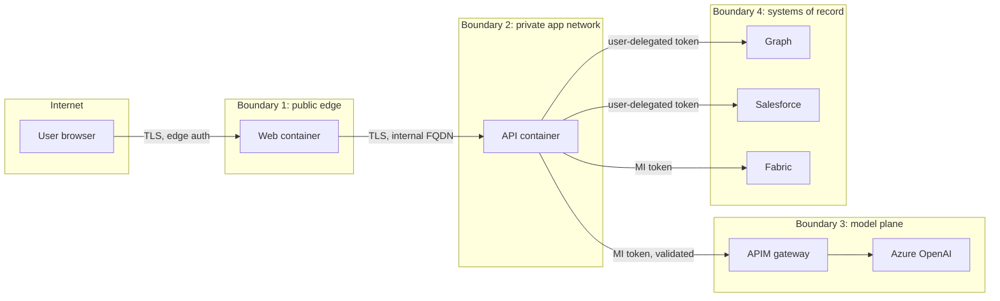
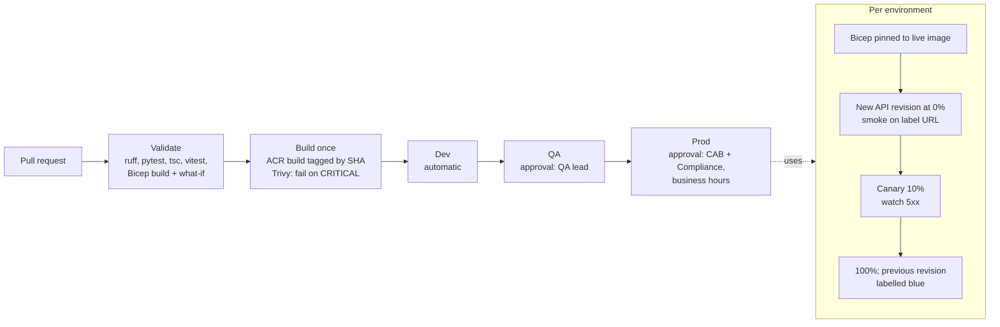
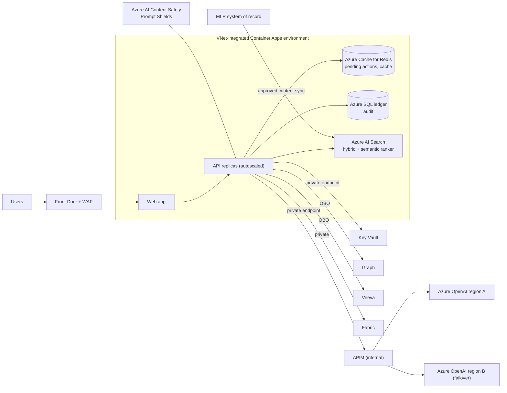

# PharmaFieldAssist — Architecture Design

| | |
| --- | --- |
| **Document type** | Solution architecture (arc42-style, C4 views) |
| **Audience** | Principal/enterprise architects, AI platform engineering, security, compliance |
| **System status** | Deployed on Azure Container Apps with API Management and Azure OpenAI; Graph, Veeva/Salesforce and Fabric on mock data in the hosted demo, live clients implemented and tested |
| **Companion documents** | [Executive brief](EXECUTIVE_BRIEF.md) · [README](../README.md) · [Runbook](RUNBOOK.md) · [Live setup](LIVE_SETUP.md) |

**Conventions.** *Target* = a design objective not yet load-tested. *Measured* = observed on the Azure deployment. Code references are relative to `backend/app/` unless stated.

---

## 1. Context and scope

PharmaFieldAssist gives a US pharmaceutical field sales force one conversational entry point to approved product information, their calendar, their CRM and their territory analytics. It does this inside the regulatory boundary that governs promotional communication, safety reporting and patient privacy.

**In scope:** conversational orchestration, six domain agents, compliance enforcement, audit, LLM access governance, integrations with Microsoft Graph, Veeva/Salesforce and Microsoft Fabric, Azure hosting and release.

**Out of scope:** authoring and MLR approval of content (consumed, not produced); the pharmacovigilance case system and the Medical Information system of record (the platform hands off to them); HCP-facing channels.

---

## 2. Architecture drivers

### 2.1 Business goals

| ID | Goal |
| --- | --- |
| BG-1 | Reduce the time a rep spends finding approved answers and switching between tools |
| BG-2 | Eliminate improvised answers to off-label questions and missed adverse-event reports |
| BG-3 | Give Compliance provable, reviewable evidence of every AI interaction |
| BG-4 | Keep AI spend predictable and bounded as usage grows |

### 2.2 Constraints

| ID | Constraint | Source |
| --- | --- | --- |
| C-1 | Product content must be MLR-approved and unexpired at the time it's shown | Promotional regulation; internal SOP |
| C-2 | Promotional content must carry fair balance (Important Safety Information) | FDA promotional requirements |
| C-3 | Adverse events must reach Pharmacovigilance within the reporting window | Safety reporting obligations |
| C-4 | Off-label questions are answered only by Medical Information | Off-label promotion rules |
| C-5 | Patient-identifiable information must not be stored or sent to models | Privacy (HIPAA-adjacent handling of PHI) |
| C-6 | Azure, Microsoft Entra ID and Microsoft 365 are the enterprise standard | Enterprise architecture |
| C-7 | Downstream systems must see the user's own identity, not a super-user | CRM row-level security, mailbox scoping |

### 2.3 Functional requirements

| ID | Requirement |
| --- | --- |
| FR-1 | Answer product questions only from approved content, with citations |
| FR-2 | Check availability and book HCP meetings in Outlook |
| FR-3 | Show territory prescription trends (TRx, NRx, market share) |
| FR-4 | Look up accounts and log calls in Veeva/Salesforce |
| FR-5 | Detect adverse events and hand off to Pharmacovigilance |
| FR-6 | Detect off-label requests and hand off to Medical Information |
| FR-7 | Require explicit user confirmation before any write to a business system |
| FR-8 | Give Compliance a searchable, verifiable audit trail |
| FR-9 | Give operators health, dependency and failure-injection controls |

### 2.4 Quality attribute scenarios

| ID | Attribute | Scenario | Response measure | Status |
| --- | --- | --- | --- | --- |
| QA-1 | Compliance | A rep asks an off-label question | Not answered by the model; routed to Medical Information; audited | Verified by tests and live |
| QA-2 | Compliance | The model drafts a sentence with a prohibited claim | Sentence removed before display; verdict recorded | Verified by tests |
| QA-3 | Safety | A rep reports a patient's adverse reaction | AE intake reference and reporting window returned; patient name redacted; `ae.flagged` audited | Verified by tests and live |
| QA-4 | Security | A caller without the app identity calls the model gateway | 401 at the gateway; no model call | Verified live (401 `TokenNotPresent`) |
| QA-5 | Security | A rep requests another territory's data | Denied before any data is fetched; audited | Verified by tests and live |
| QA-6 | Cost | Usage exceeds the daily token quota | 403 at the gateway; users receive approved-content answers | Verified by tests; throttle drill available |
| QA-7 | Availability | Azure OpenAI is throttled or down | Breaker opens after 3 failures; routing falls back to rules, Q&A to extractive answers; no 5xx | Verified by tests |
| QA-8 | Auditability | Someone edits a stored audit record | Chain verification reports the first broken sequence | Verified by tests |
| QA-9 | Performance | A cited product answer that needs a model call | p95 under 4 s end to end (target) | Measured: 2.07 s for one turn (825 ms routing, 1,240 ms answer) |
| QA-10 | Performance | A repeated product question | No model call (cache hit) | Measured: agent step about 0.1 ms |
| QA-11 | Deployability | A new API release misbehaves | Traffic back to the previous revision in one command | Rollback command emitted on every release |
| QA-12 | Modifiability | Compliance changes a prohibited phrase | Policy file change, reviewed and versioned; no code change | By design |

---

## 3. System context (C4 level 1)



---

## 4. Container view (C4 level 2)



| Container | Technology | Responsibility | Scaling unit |
| --- | --- | --- | --- |
| Web | nginx 1.27 (unprivileged), React 18 + Vite build | Static SPA, security headers, reverse proxy to the internal API | 1–2 replicas |
| API | Python 3.12, FastAPI, Pydantic v2, httpx | Orchestration, agents, compliance, audit, integrations | 1 replica today (in-process state; see §11) |
| AI gateway | API Management BasicV2 | Identity check, output contract, token limits and quotas, metering | Managed |
| Model | Azure OpenAI, GlobalStandard, 10K TPM | Classification and grounded generation | Managed capacity |

---

## 5. Component view of the API (C4 level 3)



**Dependency rule:** agents depend on `AgentContext` and domain services only. They never import HTTP, auth, audit or telemetry. This keeps agents unit-testable and lets each pipeline step become a LangGraph node without rewriting agent logic.

---

## 6. Runtime views

### 6.1 Grounded product answer



### 6.2 Write with human confirmation (calendar booking)



### 6.3 Degraded path: gateway throttling



---

## 7. Data architecture

### 7.1 Data classification and handling

| Data | Class | Where it lives | Handling |
| --- | --- | --- | --- |
| Rep's message | Confidential; may contain PHI | Request memory only | PHI/PII redacted before routing, model calls, logs and audit |
| Approved content | Internal, MLR-controlled | Markdown in the image; in-memory index | Expired or unapproved documents excluded at index time |
| Calendar events | Confidential | Microsoft 365 | Accessed as the user (OBO); not persisted |
| CRM accounts and calls | Confidential | Veeva/Salesforce | Accessed as the user or a scoped integration user; not persisted |
| Prescription data | Confidential, commercial | Fabric lakehouse | Read-only, territory-filtered, parameterised queries |
| Audit records | Restricted, regulatory | Audit store | Append-only, hash-chained, sanitized text only |
| Secrets | Secret | Key Vault | Read by managed identity at container start; never logged |
| Telemetry | Internal | App Insights / Log Analytics | Correlation IDs, event names, latencies; user message text is not logged |

### 7.2 Turn contract (`TurnResult`)

`turn_id`, `correlation_id`, `conversation_id`, `answer`, `intent`, `agent`, `route` (method, confidence, rationale), `verdicts[]`, `tool_calls[]`, `citations[]`, `pending_action`, `data`, `degraded`, `blocked`, `trace[]`, `latency_ms`, `policy_version`, `kb_version`, `audit_seq`, `audit_hash`.

The contract makes every answer self-describing: the user interface, the audit log and support engineers see the same facts.

### 7.3 Audit record and chain

```text
AuditEvent  = { event_id, ts, correlation_id, actor_oid, actor_roles[], event_type, payload }
Stored      = AuditEvent + { seq, prev_hash, hash }
hash(n)     = sha256( prev_hash(n) || canonical_json(AuditEvent(n)) )     # sorted keys, no whitespace
event_type  = chat.turn | chat.blocked | ae.flagged | action.completed | action.failed | action.cancelled | ...
```

SQLite triggers reject `UPDATE` and `DELETE`. `GET /api/audit/verify` recomputes the chain and returns `{valid, records_checked, first_broken_seq, head_hash}`.

### 7.4 Knowledge model

`Document(title, product, mlr_id, approved_until, audience)` → `Chunk(doc, section, text, mlr_id)` split on H2/H3. The index version is a SHA-256 of the corpus. It's stamped on audit records and is part of the answer-cache key `(normalised question tokens, product, kb_version)`.

---

## 8. Security architecture

### 8.1 Trust boundaries



### 8.2 Identity flows

| Flow | Mechanism | Why |
| --- | --- | --- |
| User → API | Entra ID access token (auth code + PKCE via MSAL.js); signature via JWKS, issuer, audience, expiry; `roles` and `territory` claims | Standard enterprise SSO with app roles |
| API → Graph / Salesforce | On-Behalf-Of exchange per user and scope, cached until 5 minutes before expiry | Downstream systems enforce the user's own permissions (C-7) |
| API → APIM | User-assigned managed identity token for `https://cognitiveservices.azure.com` | No keys; gateway checks the client application ID |
| APIM → Azure OpenAI | APIM's managed identity with *Cognitive Services OpenAI User* | Keys disabled on the model resource |
| Containers → ACR, Key Vault | Same managed identity (AcrPull, Key Vault Secrets User) | No registry passwords or secret values in config |

### 8.3 Threat model (STRIDE)

| Threat | Example | Control | Verification |
| --- | --- | --- | --- |
| **S**poofing | Forged user token | JWKS signature, issuer, audience, expiry checks | `test_invalid_entra_tokens`, wrong-key test |
| **S**poofing | Another workload calls the model | Gateway validates the API's managed-identity client ID | Live 401 `TokenNotPresent` |
| **T**ampering | Audit history rewritten | Hash chain + update/delete triggers + verify endpoint | Tamper-detection tests |
| **T**ampering | SQL/SOQL injection via user text | Bound parameters; whitelisted metrics and tables; `soql_literal` escaping | Escaping and query-builder tests |
| **R**epudiation | "I never booked that" | Confirm bound to user, audited with correlation ID and action ID | HITL tests |
| **I**nformation disclosure | PHI sent to model or logs | Redaction before routing, model calls, logging and audit | CMP-001 tests |
| **I**nformation disclosure | Cross-territory data | AUTHZ-201 scope before fetch; delegated identity downstream | Scope tests; live denial |
| **D**enial of service / wallet | Token flooding | Per-call cap, 20K TPM, daily and monthly quotas, 2,000-char message limit, answer cache | Quota tests; throttle drill |
| **E**levation of privilege | Prompt injection makes the model act | Injection patterns blocked; model has no tools on the answer path; writes need user confirmation | CMP-002 tests; HITL design |
| **E**levation of privilege | Role escalation | Role × agent matrix server-side; roles from token claims only | AUTHZ-101 tests |

---

## 9. AI and LLM architecture

### 9.1 Model access contract

1. **Single path:** `PFA_LLM_GATEWAY_ONLY=true` by default. The API refuses to start if the endpoint isn't `*.azure-api.net` or any API key is configured.
2. **One function:** all model calls go through `complete_json(llm, system, user, schema, max_tokens)` in `llm/provider.py`.
3. **Output contract:** JSON mode on every call; `max_tokens` clamped to `PFA_LLM_MAX_OUTPUT_TOKENS` (400); `finish_reason=length` rejected; Pydantic schema validation (`RouterOutput`, `QAOutput`).
4. **Defence in depth:** APIM rewrites every request body with the same cap and JSON mode, so any other client is constrained too.
5. **Failure semantics:** any contract violation raises `DependencyUnavailableError`, and the caller takes its deterministic fallback.

### 9.2 Prompt and context design

| Call | Budget | Inputs | Output schema |
| --- | --- | --- | --- |
| Router | 80 output tokens, temperature 0 | System instructions + sanitized message | `{intent, confidence 0–1, rationale}` |
| Product answer | 300 output tokens, temperature 0 | System rules (cite every sentence, no comparative or off-label claims, under 120 words) + up to 3 numbered approved chunks + question | `{grounded: bool, answer: str ≤ 1,500 chars}` |

Retrieved text is placed in the prompt as numbered sources, and the model can't call tools. That limits the blast radius of injected instructions inside content.

### 9.3 Routing policy

LLM classification with a closed label set → schema check → confidence floor 0.35 (below it: `clarify`). If the model is unavailable or its output is invalid, weighted keyword rules decide. Input guardrails can force a route (AE → pharmacovigilance, off-label → medical_information) before the router runs. The router never sees unredacted text.

### 9.4 Model lifecycle

- **Selection at deploy time:** the account's deployable models are listed, and the first current, non-deprecating chat model is taken from an ordered list (`gpt-4.1-mini`, `gpt-4o-mini`, `gpt-4.1-nano`, `gpt-4.1`, `gpt-4o`). Reasoning models are excluded because they ignore `max_tokens` and `temperature`.
- **Change control:** a model change is a configuration change run through the test suite and (next step) the scored evaluation set before release.

### 9.5 Evaluation strategy

| Layer | Today | Next |
| --- | --- | --- |
| Deterministic rules | 24 compliance tests, routing and parser tests | — |
| Output contract | Schema, truncation and budget tests | — |
| Answer quality | Grounding enforced at runtime (CMP-101) | Golden set scored for retrieval recall@3, groundedness and citation accuracy; release gate |
| Production | Gateway token metrics, audit sampling | Sampled online groundedness scoring; thumbs-down feedback into the golden set |
| Safety | Injection, AE and off-label test cases | Red-team set run per release |

---

## 10. Reliability design

### 10.1 Mechanisms

| Mechanism | Setting | Where |
| --- | --- | --- |
| Circuit breaker | Open after 3 consecutive failures; half-open after 30 s; close on 1 success | Every dependency (`resilience/breaker.py`) |
| Retry | 2 retries on transient errors (timeout, 429, 5xx), exponential backoff from 50 ms; none while half-open | Same |
| Timeout | LLM 20 s (`PFA_LLM_TIMEOUT_SECONDS`) | `llm/provider.py` |
| Idempotency | Graph `transactionId` = action ID | Scheduling writes |
| Health | `/health/live`; `/health/ready` = audit store reachable and index non-empty | Container probes |
| Fault injection | `error` (503) or `timeout` per dependency; disabled in prod | Platform ops |

### 10.2 Failure modes and effects

| Failure | Detection | Effect on users | Recovery |
| --- | --- | --- | --- |
| Azure OpenAI throttled or down | 429/5xx at gateway; breaker opens | Rules routing; extractive cited answers; turn marked degraded | Automatic when the breaker closes; failover deployment (roadmap) |
| Daily or monthly quota reached | 403 at gateway; `llm_quota_exhausted` | Same degraded answers until reset | Reviewed quota change |
| Model returns invalid JSON or truncates | Schema or `finish_reason` check; `llm_output_rejected` | Fallback answer; never raw model text | None needed; tracked |
| Graph / Salesforce / Fabric unavailable | Breaker opens; dependency error | Clear "temporarily unavailable" message for that capability only | Automatic; runbook playbook |
| OBO consent missing | `obo_exchange_failed` | User told consent is needed | Admin consent |
| Bad API release | Smoke test on the green revision; 5xx during canary | None if caught at 0–10% traffic | Traffic back to the labelled blue revision |
| Audit store unavailable | `/health/ready` 503 | Replica taken out of rotation | Restart; production uses managed SQL |
| Expired content in the corpus | Excluded at index build | Never served | Content refresh |

---

## 11. Performance and capacity

### 11.1 Latency budget (measured on Azure, one turn)

| Step | Measured | Notes |
| --- | --- | --- |
| Input guardrails | 0.1 ms | Compiled patterns |
| Routing (model via APIM) | 825–977 ms | Small JSON output |
| Retrieval | 0.2 ms | In-memory BM25 |
| Answer (model via APIM) | 1,240 ms | Up to 300 output tokens |
| Output guardrails | 0.1 ms | |
| Audit write | 2.7–25 ms | SQLite append |
| **Total** | **≈ 2.07 s** | Cache hit: agent step ≈ 0.1 ms |

**Cold start:** the first turn after a new revision went live measured 7.5 s end to end (5.9 s in routing; see the README screenshot). The likely cause is the first managed-identity token acquisition and new TLS connections to the gateway; to be confirmed with dependency tracing. Mitigations: warm-up request on revision start, token pre-fetch, a minimum of one always-ready replica.

**Optimisation levers, in order:** stream the answer (perceived latency); skip the router call when rules are high-confidence; route simple intents to a smaller model; raise the cache hit rate with semantic normalisation.

### 11.2 Capacity model (planning assumptions)

| Assumption | Value |
| --- | --- |
| Reps | 5,000 |
| Questions per rep per working day | 20 |
| Model calls per question | 2 (router + answer); 0 on cache hit |
| Tokens per question | ≈ 500 (router) + ≈ 500 (answer) = ≈ 1,000 |

| Derived | Value |
| --- | --- |
| Questions per day | 100,000 |
| Average / design-peak rate | ≈ 1.2 / ≈ 10 questions per second |
| Tokens per day before caching | ≈ 100 million |
| Required model throughput at peak | ≈ 600K tokens per minute |

**Implication:** today's limits (10K TPM deployment, 20K TPM gateway, 500K/day) are deliberately demo-sized. Production needs provisioned or higher GlobalStandard capacity, a second deployment behind APIM, per-team quotas, and caching treated as a first-class cost control.

### 11.3 Scaling path

The API holds pending actions, the answer cache and the audit store in process, so it runs as a single replica by design. To scale out:

1. Move pending actions and the cache to Azure Cache for Redis.
2. Move audit to Azure SQL ledger tables, or Blob storage with a time-based retention lock and the chain head exported.
3. Raise `maxReplicas` with an HTTP-concurrency scale rule.

Retrieval moves to Azure AI Search when the corpus grows beyond in-memory size or needs vector recall.

---

## 12. Observability

| Signal | Source | Use |
| --- | --- | --- |
| Request traces and exceptions | Azure Monitor OpenTelemetry → App Insights (`OTEL_SERVICE_NAME=pfa-api`) | Failures, performance, application map |
| Structured logs with correlation ID | JSON logging; `X-Correlation-ID` header | One ID joins trace, audit record and logs |
| Named events | `agent_failed`, `router_llm_fallback`, `llm_output_rejected`, `llm_quota_exhausted`, `llm_auth_rejected`, `breaker_opened`, `breaker_closed`, `obo_exchange_failed`, `fabric_query_failed` | Alerting and diagnosis |
| Gateway traffic | APIM diagnostics → App Insights (`aoai` operation) | Model call success, 401/403/429 |
| Token metrics | `azure-openai-emit-token-metric` → namespace `pfa-llm` | Cost per client and deployment |
| Model metrics | Azure OpenAI platform metrics | Processed tokens, latency, throttling |
| Business trace | `TurnResult.trace` + audit log | Per-turn explanation for users and Compliance |

**SLOs (targets):**

| SLI | Target |
| --- | --- |
| Availability (non-5xx chat responses) | 99.9% monthly |
| p95 chat latency, model path | under 4 s |
| Turns degraded by dependency failure | under 1% daily |
| Compliance controls failing open | 0; any occurrence is Sev 1 |

Alert rules are defined in `infra/modules/alerts.bicep` (5xx rate, breaker opened, chat p95, container restarts).

---

## 13. Deployment and release



- **Environments:** dev, QA and prod parameter files (`infra/*.bicepparam`). Same image promoted, never rebuilt.
- **Revisions:** the API runs in multiple-revision mode. A new revision gets 0% traffic until it passes its smoke test; rollback means moving traffic back to the blue label.
- **Configuration:** settings are validated at startup (`config.py`); invalid or incomplete live configuration fails fast instead of running degraded.
- **Operational scripts:** `pfa-azure.sh`, `pfa-apim.sh`, `pfa-azure-web.sh`, `aca-release.sh`, `aca-rollback.sh`, `pfa-throttle-drill.sh`, `pfa-azure-down.sh` (see README).

---

## 14. Cost model

| Component | Driver | Control |
| --- | --- | --- |
| Azure OpenAI | Tokens | Gateway caps and quotas; cache; small model; 400-token output ceiling |
| API Management BasicV2 | Fixed monthly (≈ $150) | Right-size the tier per environment; tear down non-prod when idle |
| Container Apps | vCPU-seconds and memory | Consumption plan; scale rules |
| Monitoring | GB ingested | WARNING-level SDK logging; no message text in telemetry |
| Governance | — | $100/month budget alerts on the resource group (alerting only) |

Measured unit cost: a cited answer used 426 prompt and 71 completion tokens. At small-model list prices that's a fraction of a cent per answer, so platform fixed costs, not tokens, dominate at pilot scale.

---

## 15. Architecture decision records

| ADR | Decision | Context | Alternatives rejected | Consequences |
| --- | --- | --- | --- | --- |
| 001 | All model access through one APIM AI gateway with managed identity | Spend and access must be controlled centrally; a past deployment overran cost | Direct SDK calls with keys per service | Central quotas, metering and audit; one more hop (tens of ms); gateway is a critical dependency, so it's monitored |
| 002 | JSON-only, schema-validated model output with deterministic fallbacks | Regulated content can't show unvalidated text | Free-text generation with post-hoc filtering | Predictable output and safe failure; prompts must be written for JSON |
| 003 | Compliance policy as versioned data, logic in code | Compliance owns wording; changes must be traceable | Hard-coded rules | Policy changes without code changes; version stamped on every record |
| 004 | Input guardrails run before routing and can force a route | AE and off-label must never depend on a model's judgement | Ask the model to detect AE/off-label | Deterministic safety routing; rule maintenance; classifier is a roadmap addition, not a replacement |
| 005 | LLM router with rules fallback and confidence floor | Paraphrase handling and resilience both matter | LLM-only; rules-only | Works through model outages; clarify path for ambiguity |
| 006 | Human confirmation for every write, user-bound, 15-min TTL, idempotent | Writes to CRM and calendars are business records | Autonomous agent actions | Slight friction; no unintended writes; repudiation covered by audit |
| 007 | On-Behalf-Of for user data, managed identity for platform | Downstream permissions must be the user's own | A service account with broad access | Correct data scoping; requires consent and app registration |
| 008 | BM25 with synonyms over MLR-gated Markdown | Small, approved corpus; reviewers need explainable retrieval | Vector-only search | Deterministic and cheap; Azure AI Search hybrid is the scale path behind the same `search()` contract |
| 009 | Hash-chained append-only audit | Compliance needs tamper evidence | Plain application logs | Verifiable history; production storage must be immutable |
| 010 | Plain async pipeline shaped as graph nodes | Prove the flow before adding framework weight | Adopting an agent framework on day one | Fewer moving parts; one-to-one migration to LangGraph when branching grows |
| 011 | Container Apps with multiple revisions | Need blue/green and canary without running Kubernetes | AKS; App Service | Revision-level traffic control; fewer knobs than AKS |
| 012 | API on internal ingress; web container as the only public entry | Reduce exposed surface | Public API with CORS | Single edge to harden; nginx owns headers and token mapping |

---

## 16. Target production architecture



Additions over today: WAF at the edge; private networking end to end; shared state for horizontal scale; immutable audit storage; hybrid retrieval synchronised from the MLR system; multi-region model capacity behind the gateway; classifier-based safety screening alongside the deterministic rules; and a scored evaluation gate in the pipeline.

---

## 17. Assumptions and open questions

| # | Item | Owner |
| --- | --- | --- |
| 1 | Territory and role claims will be issued by Entra ID (app roles + a custom claim) | Identity team |
| 2 | Pharmacovigilance and Medical Information intake APIs for direct submission (today: reference and hand-off) | PV and MI system owners |
| 3 | The MLR system can export approved content with approval IDs and expiry dates | Commercial content operations |
| 4 | Audit retention period and legal-hold requirements | Compliance / Legal |
| 5 | Pilot quota sizing per district | AI product owner |
| 6 | Data residency constraints for model regions | Security / Legal |
